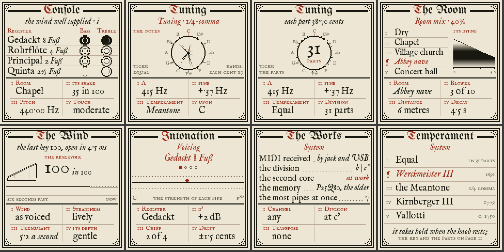

# KIST

A physically modelled continuo organ for the M-VAVE FM-1, after the Dutch box organs (kistorgels) of the Klop
workshop: one manual, four wooden stops, every pipe computed live as a digital waveguide. No samples.

| Stop | Pipes | Model |
|---|---|---|
| Gedackt 8' | 54, C..f''' | stopped wood |
| Rohrflöte 4' | 54 | stopped wood with a chimney resonance |
| Principal 2' | 54 | open wood |
| Quint 2 2/3' | 30, c'..f''' (treble only) | open wood, a pure twelfth |

Each stop is split bass | treble at c' (adjustable), so seven stop halves; 192 pipes in all, 12 notes, up to 48
pipes at once.

Built on [fm1-base](https://github.com/charlesvestal/fm1-base) (felucca-bsp underneath, MPL-2.0, no closed code).

## Playing it

**Stops** (top row): FX / SEL = Gedackt bass / treble, ENV / LFO = Rohrflöte, EDIT / GLO = Principal, ARP = Quint
(treble). A lit button is a drawn stop. Drawing or retiring a stop while you hold keys works as on a real organ.

**Bottom row**: HOME = the Console page. SAVE = keep this setup for the next power-on (lit while something is
unsaved). SEQ = tremulant. PLAY = the blower (green while it runs; switched off, held notes die as the reservoir
empties). REC = cancel every stop; press again to bring them back.

**Knobs**: SELECT = page, PRESETS = room mix, ALGORITHM = temperament (from any page; applies when the knob rests
0.6 s). K1..K4 = what the page's footer shows, laid out as the knobs are. MASTER = volume. OCT- / OCT+ = move the
FM-1's own keys; both together = back to 0.

| Page | K1 | K2 | K3 | K4 |
|---|---|---|---|---|
| 1 Console | room | room mix | pitch (A, Hz) | touch |
| 2 Tuning | pitch, whole Hz (300..500; a quick turn moves 10, holds a moment at 392, 415, 432, 440, 465) | hundredths (carry into the Hz) | system | root (temperaments) or divisions per octave (Equal, 5..72, default 12) |
| 3 Room | room | blower noise | distance | decay |
| 4 Wind & touch | pressure | steadiness | tremulant speed | tremulant depth |
| 5 Voicing | stop | level of the note last played on the FM-1 | chiff | pipe drift |
| 6 System | MIDI channel | split | MIDI transpose | |

**Keys**: the FM-1's own keys play with velocity. MIDI comes in on the 3.5 mm TRS jack (an Osmose's DIN MIDI Out
through a DIN-to-TRS adapter: check which TRS wiring the FM-1 expects) and over USB. Use the Osmose in its
traditional MIDI mode: the organ answers note on/off and velocity, all-notes-off; the sustain pedal is ignored,
as on an organ. Velocity sets how fast a pallet opens (a tracker action's feel), not the loudness.

## Tuning

Five systems: Equal (any number of divisions, 5..72; 12 is ordinary equal temperament), Werckmeister III,
1/4-comma meantone, Kirnberger III and Vallotti, each on any root. A = 300.00 .. 500.99 Hz. A is always exact at the
reference; with an equal division, each key is one division.

The jet pulls a flue pipe off its resonator's pitch; `dsp/calib_table.h` (made by `tools/calibrate.c` from this
exact model) corrects it. Measured on the computer: every pipe of every stop within 0.47 cents below 1.5 kHz, at
every reference tested from A300 to A500.99, rms under 0.15 cents. Above 1.5 kHz pipes run 2x oversampled on the
second core (within 0.12 cents); without the second core they stay within 1.2 cents. The default pipe drift
(+-1.5 cents, VOICING) is on top of that, on purpose: a real organ is never dead in tune.

## The second core

Started at power-on. When it runs it takes the pipes above 1.5 kHz at twice the rate, part of the ordinary pipes,
and the richer room (one block, 5.8 ms, later). On some FM-1s it misreads shared memory now and then: whatever it
hands back is checked before it reaches the speakers, and fm1-base retires it for good (until power-off) at the
first sign of trouble. The organ is built to play fully on one core; the System page shows the core's state.

## The screen

The pages are drawn as a Baroque engraving: ink and red on paper, a double-ruled border, Fraktur titles and
Fell types (`ui/engraving.c`), sized on the old printers' scale (labels 12 px, lists and captions 16, values 18,
titles 24). The four knobs are a table at the foot of every page, i–iv, each a small red label over its value. The
Tuning page is a clock face: the equal steps as ticks round the dial, each note a dotted hand, its offset from the
tick drawn three times over. The faces are
rendered into bitmap fonts by `tools/gen_kist_fonts.py` (into `ui/kist_fonts.h`) from:

- UnifrakturMaguntia, SIL Open Font License 1.1 (`assets/fonts/OFL-UnifrakturMaguntia.txt`)
- IM Fell English, roman, italic and small capitals, by Igino Marini, SIL Open Font License 1.1
  (`assets/fonts/OFL-IMFell.txt`)

## Building

    git clone --recursive https://github.com/78Hz/kist
    python3 fm1-base/tools/build.py . --host        # the simulator: build/host/kist_host
    build/host/kist_host tests/host/basic.txt build/host     # the scripted test, with screenshots

    tools/build_tools.sh                            # the engine's own tools and tests (cc)
    build/engine_test                               # tuning, temperaments, render, WAVs in build/wav/
    build/calibrate > dsp/calib_table.h             # after any change to a stop's model constants

    JIELI_TOOLCHAIN=... AC79_SDK=... python3 fm1-base/tools/build.py .   # the firmware: build/kist.fwsc

The toolchain and SDK: `fm1-base/tools/get_toolchain.sh`, or the mirrors of
[setup-fm1-toolchain](https://github.com/DimmKirr/setup-fm1-toolchain)'s releases.

## Installing

Download `kist-X.Y.fwsc` from the [latest release](https://github.com/78Hz/kist/releases/latest), then either:

- The [manual](docs/manual/KIST-manual.pdf) explains the instrument for players.
- **FM-1 Manager** (the same release, for macOS, Windows and Linux): open it, add the file under Firmware and
  press *Install on FM-1*. It also takes backups and puts M-VAVE's firmware back. See [manager/](manager/).
- **The command line**: `python3 fm1-base/tools/fm1_install.py kist-X.Y.fwsc`
  (`pip install mido python-rtmidi` first).

Connect the FM-1 straight to the computer with a USB data cable, switched on as normal: no update mode is needed.
Before the first install, take a whole-flash backup (FM-1 Manager → Whole flash) while M-VAVE's firmware is
still on it.

Both FM-1 flash chips are recognised (the older Puya P25Q80, the newer UC25HQ80); on an unknown chip the organ
plays but does not save. SAVE writes the flash, which stops everything for a moment, the sound too: save between
pieces. The saved setup can be backed up and restored over USB (FM-1 Manager → Saved data).

To go back: install M-VAVE's `FM-1.fwsc` the same way (or with M-VAVE's M-UPGRADE). An FM-1 that won't start
shows SAFE MODE after two tries, where USB still works; failing that, FM-1 Manager → Whole flash → *Put M-VAVE
firmware back*, or felucca-bsp's `tools/fm1_rescue.sh`.

## Releases

A tag `vX.Y`, or running the Build workflow by hand with a version, builds everything on GitHub (`.github/workflows/build.yml`): the release firmware
(`kist-X.Y.fwsc`, identity FM-1_57XXYY00, and `firmware.json`), the tests, and FM-1 Manager for each platform.
Every push to main builds and tests the firmware the same way.

## Licence

KIST is under the [Mozilla Public License 2.0](LICENSE), as fm1-base and felucca-bsp. The screen's faces are
under the SIL Open Font License 1.1 (see *The screen*).

## Not yet known

- **The real pipe count on the device.** The pipe loop is 88 instructions a sample (Rohrflöte 109) in the
  firmware's code; the cycles each takes on the FM-1 are not measured. The render times itself every block and
  allows fewer pipes if it runs long (over 70 % of its time), closing the least important ones over 85 %: the
  System page shows the load and the pipes allowed. Run a full chord with every stop on the device to find out.
- **The sound on the FM-1's own speaker and outputs**: heard so far only as renders on a computer.
- The wood pipes' voicing is a first pass, set from spectra and attack times; it wants ears.
